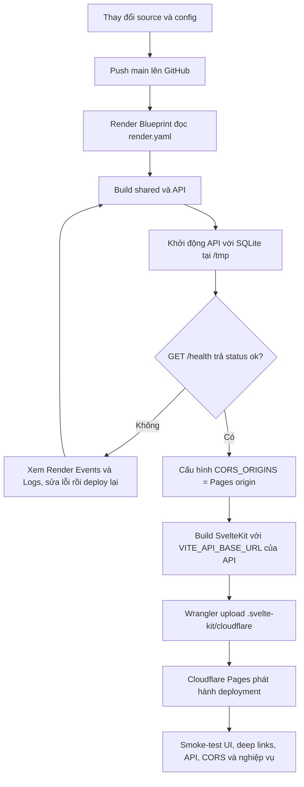

# Quy trình triển khai demo

## Hạ tầng và URL

| Thành phần | Hosting | URL |
| --- | --- | --- |
| Admin UI | Cloudflare Pages | <https://multi-tenant-configuration-platform.pages.dev/> |
| Express API | Render Free Web Service | <https://multi-tenant-configuration-api.onrender.com/> |
| API health check | Render | <https://multi-tenant-configuration-api.onrender.com/health> |

Source triển khai trên nhánh `main` của
[`nmkhanh1990/multi-tenant-configuration-platform`](https://github.com/nmkhanh1990/multi-tenant-configuration-platform).
Commit cấu hình/app ban đầu: `639ea80`; commit ghi URL demo: `69d8b27`.

## Sơ đồ luồng deploy



Trong lần triển khai đầu, project Pages được tạo trước để chọn hostname dự kiến
`multi-tenant-configuration-platform.pages.dev`; sau đó API được deploy với origin
này trong `CORS_ORIGINS`, rồi UI được build với API URL public và phát hành. Luồng
sau mô tả chính xác việc đã làm, không phải hai lần deploy UI như hướng dẫn khởi
tạo trên Dashboard.

## Quy trình thực tế đã chạy

### 1. Publish source

1. Kiểm tra build và test cục bộ.
2. Commit và push cấu hình deploy cùng các thay đổi UI lên `main`:
   `639ea80 Prepare free demo deployment`.
3. Sau khi có URL thật, cập nhật README và push:
   `69d8b27 Document live demo URLs`.

Không đưa credential hoặc secret vào Git.

### 2. Tạo và deploy API trên Render

1. Trong Render Dashboard, tạo **Blueprint Instance** từ repository GitHub.
2. Blueprint lấy cấu hình từ `render.yaml` ở root repository:
   - Runtime: Node.js; plan: Free.
   - Build: cài pnpm dependencies, build `@mtcp/shared`, rồi build `@mtcp/api`.
   - Start: `node apps/api/dist/index.js`.
   - Health check: `/health`.
   - `DATABASE_PATH=/tmp/platform.sqlite`.
   - Đặt `CORS_ORIGINS` thành origin chính xác của Cloudflare Pages,
     không thêm path hoặc slash cuối.
3. Chờ deployment thành công. Kiểm tra:

   ```sh
   curl https://multi-tenant-configuration-api.onrender.com/health
   ```

   Kết quả mong đợi:

   ```json
   {"status":"ok"}
   ```

4. Kiểm tra API list tenant trả về ba fixtures khi database mới/rỗng.

### 3. Tạo và deploy UI lên Cloudflare Pages

Project `multi-tenant-configuration-platform` được tạo trong Cloudflare account;
Pages hostname là `https://multi-tenant-configuration-platform.pages.dev`.
SvelteKit dùng `@sveltejs/adapter-cloudflare`, output `.svelte-kit/cloudflare`;
`wrangler.jsonc` chứa Pages output directory và compatibility date.

Với repository đã clone, cài dependency và build theo thứ tự shared → web. Cần đặt
`VITE_API_BASE_URL` **tại thời điểm build**, vì giá trị này được nhúng vào client:

```powershell
$env:VITE_API_BASE_URL = "https://multi-tenant-configuration-api.onrender.com/api"
pnpm install --frozen-lockfile
pnpm --filter @mtcp/shared build
pnpm --filter @mtcp/web build
```

Từ root monorepo, phát hành output Cloudflare bằng Wrangler:

```powershell
pnpm dlx wrangler pages deploy apps\web\.svelte-kit\cloudflare `
  --project-name multi-tenant-configuration-platform `
  --branch main
```

Wrangler cần đăng nhập Cloudflare trước khi deploy. Sau khi hoàn tất, credential
CLI đã được đăng xuất khỏi máy làm việc; token không được lưu trong repository.
Pages được phát hành bằng Wrangler CLI; Render Blueprint được kết nối với GitHub
và có thể tự đồng bộ commit mới.

### 4. CORS và kết nối UI/API

- Render `CORS_ORIGINS` phải bằng `https://multi-tenant-configuration-platform.pages.dev`.
- UI `VITE_API_BASE_URL` phải bằng
  `https://multi-tenant-configuration-api.onrender.com/api`.
- Nếu thay hostname Pages, cập nhật `CORS_ORIGINS` phía Render rồi deploy API lại.
- Sau khi đổi API URL trong UI, build lại UI và deploy Pages lại.

### 5. Kiểm tra sau deploy

Các kiểm tra đã thực hiện thành công:

- `GET /health` trên API public trả `{"status":"ok"}`.
- `GET /api/tenants` trả ba tenant mẫu.
- Preflight OPTIONS cho origin Pages trả `Access-Control-Allow-Origin` đúng.
- Pages trả HTTP 200 cho `/`, `/tenants/create`, `/tenants/govhealth`.
- UI hiển thị `Connected to API`, danh sách ba tenant và trang chi tiết.
- So sánh GovHealth với HealthFirst trả kết quả khác biệt.
- Claim preview GovHealth trả committee routing, required documents,
  notifications, SLA deadline và trạng thái custom-field validation.

## Triệu chứng thường gặp

| Triệu chứng | Kiểm tra/xử lý |
| --- | --- |
| UI báo API unavailable | Kiểm tra Render `/health`, `VITE_API_BASE_URL` build-time, rồi build/deploy UI lại. |
| Browser báo CORS | So sánh origin Pages chính xác với `CORS_ORIGINS` trên Render; redeploy API nếu chỉnh. |
| Deep link không tải được | Kiểm tra Pages deployment output `.svelte-kit/cloudflare` và truy cập URL trực tiếp; thử lại sau khi deploy thành công. |
| API thức dậy chậm/lần gọi đầu timeout | Render Free spin down sau khoảng 15 phút không có traffic; đợi khoảng một phút và thử lại. |
| Tenant thay đổi biến mất | SQLite nằm trên filesystem ephemeral `/tmp`; restart/redeploy/spin down có thể xóa database. Ba tenant mẫu được seed lại khi API khởi động với DB rỗng. |

## Giới hạn an toàn và vận hành

- Đây là demo công khai để đánh giá, không dành cho production.
- Demo không có bước đăng nhập/xác thực; mọi người truy cập cùng một API và có
  thể xem hoặc thay đổi dữ liệu tenant trong database hiện tại.
- Không nhập dữ liệu cá nhân hoặc claim thật; người truy cập có thể thấy cấu hình
  tạo bởi người khác trong khi cùng một database còn hoạt động.
- Notification trong preview chỉ biểu diễn event/channel dự kiến; hệ thống không
  gửi email, SMS hoặc webhook thực.
- Dữ liệu tenant và version history không đảm bảo persistence trên Render Free.
- Nếu production cần dữ liệu bền vững, cần chuyển SQLite sang storage bền vững hoặc
  database managed phù hợp và thiết kế backup/restore; phần đó nằm ngoài demo này.
