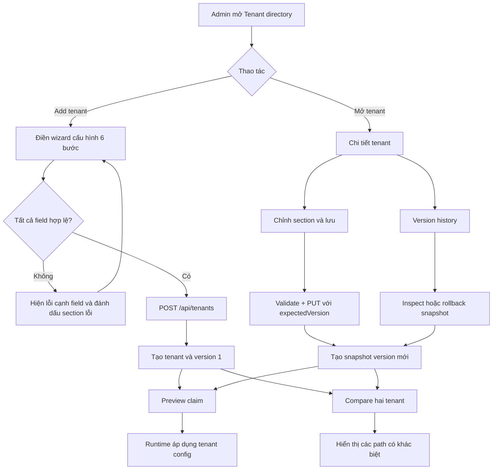

# Hướng dẫn nghiệp vụ

## Tổng quan

Admin quản lý cấu hình theo tenant. Mỗi tenant điều khiển trải nghiệm claim riêng:
branding, claim types và documents, approval, notification channels, SLA và
custom fields. Cùng một claim có thể tạo kết quả khác nhau khi chạy theo cấu hình
của các tenant khác nhau.

- Demo: <https://multi-tenant-configuration-platform.pages.dev/>
- Tenant directory: `/`
- Tạo tenant: `/tenants/create`
- Chi tiết tenant: `/tenants/<tenant-id>`
- API base: <https://multi-tenant-configuration-api.onrender.com/api>

Demo không yêu cầu đăng nhập và mọi người dùng chung cùng một tập tenant. Chỉ
dùng dữ liệu giả lập; các thay đổi của bạn có thể nhìn thấy với khách truy cập
khác trước khi Render xóa/reseed database.

Ba tenant mẫu:

| Tenant | Segment | Claim types bật | Auto-approval threshold | Approval roles | Notifications | SLA | Custom fields |
| --- | --- | --- | ---: | --- | --- | --- | --- |
| SafeGuard Insurance | Corporate | OUTPATIENT, INPATIENT, DENTAL | 20,000 | assessor, team lead, director | Email | OUTPATIENT 5, INPATIENT 10, DENTAL 5 ngày làm việc | Employee ID bắt buộc |
| HealthFirst | Retail | Cả 5 loại | 5,000 | assessor, manager | Email, SMS | 7 ngày làm việc mỗi loại | Không có |
| GovHealth | Government | OUTPATIENT, INPATIENT | 0 | committee | Email, webhook | 15 ngày làm việc mỗi loại | Department, Budget Code bắt buộc |

Loại claim: `OUTPATIENT`, `INPATIENT`, `DENTAL`, `MATERNITY`, `OPTICAL`.

## Luồng nghiệp vụ

## 1. Tạo tenant

1. Mở **Tenants** rồi chọn **Add tenant**. Màn hình tạo tenant mở tại
   `/tenants/create`; bước đầu tiên **Identity & branding** được chọn.
2. Điền **Company name**. Tenant ID được tạo tự động thành kebab-case
   (ví dụ `Example Health Group` → `example-health-group`).
3. Có thể chỉnh **Tenant ID** thủ công; ID phải gồm chữ thường, số và dấu gạch
   ngang, không có dấu gạch ngang ở đầu/cuối. ID không được trùng tenant hiện có.
4. Điền segment, logo URL và hai màu thương hiệu.
5. Hoàn tất section hiện tại rồi chọn **Next**. Các section sau chỉ mở khi tiến
   đến; có thể quay lại sửa phần trước. Nếu một section đã đi qua bị invalid, UI
   hiển thị dấu cảnh báo tại section đó.
6. Hoàn tất sáu section:
   1. Identity & branding
   2. Claim types & documents
   3. Approval rules
   4. Notifications
   5. Service levels
   6. Custom fields
7. **Create tenant** chỉ được bật khi toàn bộ cấu hình hợp lệ. Lỗi được hiển thị
   ngay dưới field liên quan. Khi tạo thành công, tenant được lưu với version đầu
   tiên và UI chuyển tới `/tenants/<id>`.

Quy tắc validation đáng chú ý:

- Phải có ít nhất một claim type enabled.
- Mỗi claim type enabled phải có SLA dương.
- Approval threshold không âm; tier đầu tiên bắt đầu đúng threshold; các tier
  liền nhau, không chồng lấn; tier cuối không có giới hạn trên.
- Tài liệu không thể vừa required vừa optional cho cùng claim type.
- Custom-field ID duy nhất, dạng snake_case bắt đầu bằng chữ thường; trường
  `select` phải có ít nhất một option.
- Màu phải có dạng hex hợp lệ; logo có thể để trống hoặc nhập URL hợp lệ.

## 2. Cấu hình tenant

Mở tenant trong directory bằng cách chọn tên hoặc **Open**. URL chi tiết là
`/tenants/<id>`. Chọn một section bên trái; nội dung section hiện tại xuất hiện
ở khung bên phải.

### Identity & branding

- Sửa company name, segment, logo URL, primary color, secondary color.
- Tenant ID của tenant đã tồn tại không đổi trong màn hình edit.

### Claim types & documents

- Bật/tắt từng loại claim.
- Với loại claim enabled, khai báo required và optional documents; mỗi dòng dùng
  định dạng `document_id | Tên hiển thị`.
- Chỉ claim type enabled mới được runtime chấp nhận.

### Approval rules

- Đặt auto-approval threshold và cấu hình các khoảng tiền/tier.
- Claim có amount **nhỏ hơn** threshold auto-approve.
- Claim bằng threshold hoặc cao hơn phải khớp approval tier; khoảng tier là
  `[minAmount, maxAmount)`, tier cuối có `maxAmount = null`.

### Notifications

- Chọn channel cho từng event: `claim_submitted`, `approved`, `rejected`,
  `payment_sent`.
- Channel hiện hỗ trợ `email`, `sms`, `webhook`; có thể cấu hình email template.
- Trong bản demo, đây là cấu hình đầu ra cho preview/runtime; không có integration
  thực sự gửi notification.

### Service levels

- Khai báo số ngày làm việc theo claim type enabled.
- Đặt số ngày làm việc trước escalation và danh sách role nhận escalation.
- Deadline hiện bỏ qua thứ Bảy/Chủ nhật; chưa tính ngày lễ.

### Custom fields

- Tạo field bổ sung với ID, label, type (`text`, `number`, `date`, `select`),
  required flag và options cho `select`.
- Ví dụ: SafeGuard yêu cầu `Employee ID`; GovHealth yêu cầu `Department` và
  `Budget Code`.

### Lưu thay đổi

1. Sửa một hoặc nhiều field ở các section.
2. Nhấn **Save configuration** trong màn hình chi tiết.
3. Client và API kiểm tra schema. Nếu hợp lệ, API lưu cấu hình mới thành version
   kế tiếp; cập nhật có gửi `expectedVersion` để phát hiện ghi đè/stale write.
4. Nếu có lỗi, sửa field được báo rồi lưu lại. Version cũ vẫn còn trong history.

Xóa tenant bằng **Delete** và xác nhận. Thao tác này xóa tenant cùng toàn bộ
version history của tenant đó và không thể undo.

## 3. Xử lý claim bằng Claim preview

Claim preview là mô phỏng; không lưu hoặc submit claim.

1. Chọn **Claim preview** ở navigation.
2. Chọn tenant và claim type đang enabled.
3. Nhập amount không âm và submission date.
4. Điền các custom fields được yêu cầu (ví dụ GovHealth cần Department và Budget
   Code; SafeGuard cần Employee ID).
5. Chọn **Run claim preview**.
6. Đọc kết quả:
   - **Approval routing**: auto-approval hoặc approver role/tier.
   - **Required documents** của loại claim đó.
   - **Notifications** cho các event được kích hoạt và channel tương ứng.
   - **SLA deadline** và target business days.
   - **Custom field validation** và lỗi cụ thể nếu thiếu/sai dữ liệu.

Quy tắc runtime:

1. Validate claim type, amount, timestamp và custom field payload.
2. Từ chối claim type không enabled cho tenant.
3. Nếu `amount < autoApprovalThreshold`, claim được auto-approve. Notification
   events là `claim_submitted` và `approved`.
4. Nếu không auto-approve, tìm tier thỏa `minAmount <= amount < maxAmount`
   (hoặc không có upper bound nếu `maxAmount = null`). Notification event là
   `claim_submitted`.
5. Lấy required documents và SLA theo claim type.
6. Tính deadline bằng submission date cộng số ngày làm việc, bỏ cuối tuần.
7. Validate custom fields bắt buộc và kiểu dữ liệu. Preview trả `valid` cùng
   danh sách lỗi thay vì lưu claim.

Do ngưỡng và cấu hình của mỗi tenant khác nhau, cùng một claim có thể tạo
approval role, tài liệu, notification, SLA và custom-field kết quả khác nhau.

## 4. So sánh cấu hình tenant

1. Chọn **Compare tenants**.
2. Chọn hai tenant khác nhau ở hai phía của màn hình compare.
3. UI gửi `POST /api/tenants/compare`; API tính diff đệ quy giữa cấu hình.
4. Xem các path và giá trị hai bên để nhận diện khác biệt trong branding, claim
   type, documents, approval, notifications, SLA hoặc custom fields.

Không thể so sánh tenant với chính nó. Phần hiển thị value định dạng dữ liệu theo
kiểu tương ứng: JSON object được trình bày dễ đọc, mảng primitive bằng badge,
boolean bằng dấu trạng thái, màu bằng color input chỉ đọc, logo bằng ảnh và giá
trị rỗng bằng “Not configured”.

## 5. Xem lịch sử và rollback

1. Mở tenant detail → **Version history**.
2. Chọn một snapshot để xem metadata, summary và khác biệt so với cấu hình hiện tại.
3. Chọn **Restore this version** để rollback.
4. API phục hồi nội dung snapshot đã chọn nhưng ghi thành một version mới; không
   sửa hoặc xóa snapshot cũ.

## API tham khảo nhanh

Các endpoint ngoài health check nằm dưới `/api`:

| Method | Path | Nghiệp vụ |
| --- | --- | --- |
| `GET` | `/tenants` | Danh sách tenant |
| `POST` | `/tenants` | Tạo tenant và version đầu |
| `GET` | `/tenants/:tenantId` | Đọc tenant |
| `PUT` | `/tenants/:tenantId` | Lưu cấu hình thành version mới; cần `expectedVersion` |
| `DELETE` | `/tenants/:tenantId` | Xóa tenant và history |
| `GET` | `/tenants/:tenantId/versions` | Liệt kê snapshots |
| `GET` | `/tenants/:tenantId/versions/:version` | Đọc một snapshot |
| `POST` | `/tenants/:tenantId/versions/:version/rollback` | Rollback thành version mới |
| `POST` | `/tenants/compare` | So sánh hai config |
| `POST` | `/tenants/:tenantId/preview` | Preview claim cho tenant |
| `POST` | `/claims/process` | Xử lý claim bằng `{ "tenantId", "claimData" }` |

## Dữ liệu demo và lưu ý

- API seed ba tenant mẫu nếu SQLite database trống.
- Render Free dùng `/tmp/platform.sqlite`, filesystem ephemeral; tenant do người
  dùng tạo, các thay đổi và version history có thể mất khi restart, redeploy hoặc
  spin down. Sau khi database rỗng, ba sample tenants được seed lại.
- Render Free có cold start; không nên đánh giá service unavailable ngay sau thời
  gian idle nếu request đầu đang đánh thức service.
- Dùng dữ liệu giả lập, không dùng thông tin sức khỏe, claim hoặc dữ liệu cá nhân
  thật trên demo public.
